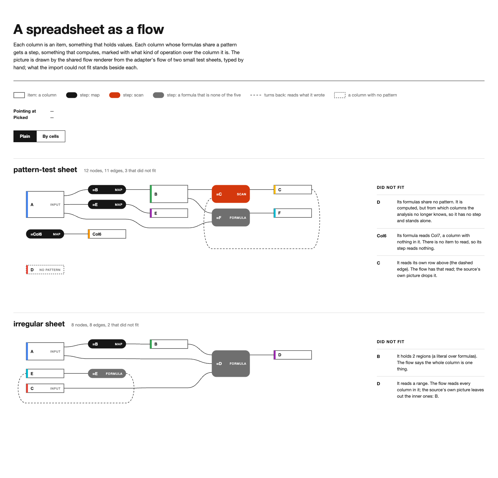

# hylograph-flow-render

One drawing for every flow.

[`hylograph-flow`](https://github.com/afcondon/purescript-hylograph-flow)
is a value for pictures of computation: items that hold values, steps that
compute, wires between them, and `project`, which turns a flow into plain
nodes and edges. This package draws that projection: a layout of it, by
whichever layout engine you hand it (its own is a layered layout, left to
right), and an SVG of that layout as a
[HATS](https://github.com/afcondon/purescript-hylograph-selection) tree.
It knows nothing about where a flow came from, and the tree knows nothing
about which engine laid it out.



*Two small spreadsheets as flows. Columns are items (open boxes); each
column of formulas is a step (a filled lozenge), coloured and noted by the
caller's decoration; a dashed edge turns back to close a cycle.*

## What it does

- **The layout is pluggable.** A layout engine is a value: `Engine wire`
  holds a name, a function from a `Picture` and a projection to a
  `Layout`, and the laws the engine promises to keep. Any engine's
  `Layout` is drawn by the one `tree`, held to the one set of general
  laws, and measured by the one set of measures. The package's own engine
  is `sankey metrics widths`; it is designed to take two more, a port of
  ELK's layered algorithm (ports, right-angled routes) and a rewrite of
  Graphviz dot (clusters, splines, ranks), neither of which it depends on.
- **A layout says where everything is, as data.** Placed nodes with their
  boxes and the ports the engine placed (which port, which side, how far
  along it); placed edges with the wires each stands for and its *route*
  as a value, not a path string: a `Ribbon` (the Sankey engine's), a
  `Polyline` with its line jumps, or a `Spline`; outlines for open groups;
  and the direction the flow runs. The SVG path is derived from the route,
  and so is everything measured of it.
- **One Sankey layout for two pictures.** In the Sankey engine every edge
  has a width. `Plain` gives each edge one unit and draws it as a hairline:
  a DAG. `Sankey f` reads each edge's width from what its wires carry and
  draws it as wide as it is. The positions come from the same code either
  way, the Sankey layout of `hylograph-layout`.
- **Cycles and strays are placed, not refused.** An edge that closes a
  cycle (an edge from a node to itself among them) runs back under the
  picture in a channel of its own. A node no edge touches stands on a shelf
  below.
- **The dress is the caller's.** Labels, notes, classes and colours come
  from a `Decoration`; what an `Overlay` knows of an element changes its
  mark; clicks and the pointer's coming and going are reported by element.
- **A closed group is a step like any other, unless the caller says so.**
  `hylograph-flow`'s `collapse` makes a closed group one step and, where it
  provides anything, one summary item. They are drawn as steps and items
  are; `withGroups` changes their marks by group, and `groupOf` says which
  group a clicked element is, for a page that opens a group where it
  stands.
- **An open group is an outline.** Tell the picture the grouping and which
  groups are closed (what `collapse` was told) and every open group that
  holds a drawn node gets a quiet box round its members with its name
  above them, a group inside it nested in it. No node that is not a member
  is inside an outline: that is a general law, of every engine. A click on
  an outline's name is told as `PointedGroup`, so a page can shut a group
  where it stands.
- **Words the layout makes room for.** Tell the picture what is written in
  each node (a title, and a line of detail) and the engine wraps the words
  to the node's breadth and makes the node tall enough. The layout is
  pure and measures no text: it estimates widths from a table of character
  classes (`Hylograph.Flow.Render.Text` says how, and how wrong it can be:
  measured once in Helvetica Neue, what was drawn was 0.87 to 1.01 of the
  estimate; more in a face of other proportions).
- **Laws, split by what they are true of.** `Hylograph.Flow.Render.Laws`
  holds every layout to the *general* laws (every node placed once, no two
  boxes overlapping, every route starting and ending on its two nodes and
  at the port where one is placed, outlines holding their members and
  nothing else) and an engine's layout to exactly the laws that engine
  *promises* (edges with the flow, layers in line, right-angled routes,
  widths conserved). An engine that conserves no widths is not asked
  whether it does. Each fault names its law, so your tests can hold the
  layout of your own flows, or your own engine, to them.
- **Measures.** `Hylograph.Flow.Render.Measures`: crossings, edge length,
  bends, area and aspect, node overlaps, edges through nodes that are not
  their ends, edges through outlines they do not end in. Each is defined
  exactly in the module's header and works on any engine's layout.

## Usage

```purescript
import Prelude

import Data.Maybe (Maybe(..))
import Data.Set as Set
import Effect (Effect)
import Hylograph.Flow (Drawing(..), Flow(..), GroupId(..), ItemId(..), PortName(..), StepId(..), WireId(..), plain, project)
import Hylograph.Flow.Grouping (Grouping(..), collapse)
import Hylograph.Flow.Render.Engine (Engine, Layout, Picture, plainPicture, run)
import Hylograph.Flow.Render.Layout (layout)
import Hylograph.Flow.Render.Sankey (Widths(..), defaultMetrics, sankey)
import Hylograph.Flow.Render.Tree (plainDecoration, tree)
import Hylograph.HATS (Tree)
import Hylograph.HATS.InterpreterTick (rerender)

-- Flour and water are mixed into dough.
bakery :: Flow Unit Unit Unit
bakery = Flow
  { items: [ item "flour", item "water", item "dough" ]
  , steps: [ { id: StepId "mix", name: Just "mix", inputs: [ PortName "dry", PortName "wet" ], outputs: [ PortName "out" ], payload: unit } ]
  , wires: map plain
      [ Reads (ItemId "flour") (StepId "mix") (PortName "dry")
      , Reads (ItemId "water") (StepId "mix") (PortName "wet")
      , Writes (StepId "mix") (PortName "out") (ItemId "dough")
      ]
  }
  where
  item name = { id: ItemId name, name: Just name, count: 1, payload: unit }

-- Where everything goes: items and steps both drawn, every edge a hairline.
placed :: Layout Unit
placed = layout defaultMetrics Plain (project Both bakery)

-- The picture, as a HATS tree: one SVG.
picture :: Tree
picture = tree plainDecoration placed

-- In a browser: put the picture in the element with the id `chart`.
draw :: Effect Unit
draw = void (rerender "#chart" picture)

-- The mixing is a group, and it is open: nothing is closed.
kitchen :: Array Grouping
kitchen = [ Group (GroupId "kitchen") "Kitchen" [ Member (StepId "mix"), Holds (ItemId "flour"), Holds (ItemId "water") ] ]

-- What any engine is told beside the projection: the group, and what is
-- written in each node.
setting :: Picture
setting = plainPicture
  { groups = Just { grouping: kitchen, closed: Set.empty }
  , words = Just \node -> { title: node.label, detail: Just "as weighed this morning" }
  }

-- An engine is a value. This is the Sankey engine with narrower nodes;
-- its metrics and widths are its own, not the picture's.
narrow :: Engine Unit
narrow = sankey (defaultMetrics { nodeBreadth = 88.0 }) Plain

-- The kitchen outlined round its three nodes, each tall enough for a
-- title and a line under it; a click on the outline's name is told to the
-- decoration's `notify` as `PointedGroup (GroupId "kitchen")`.
outlined :: Layout Unit
outlined = run narrow setting (project Both (collapse kitchen Set.empty bakery))
```

This example is compiled and checked with the tests
(`test/Test/Render/Example.purs`).

`layout metrics widths` is `run (sankey metrics widths) plainPicture`: the
door 0.2 came in by, still open.

For a Sankey, put a quantity on the wires (`Flow item step Number`, say)
and pass `Sankey` a function from an edge to its width. An edge carries
the wires it stands for, so the width of an edge that is one wire is
`(NonEmptyArray.head edge.wires).payload`.

## Writing an engine

An engine is `Engine { name, promises, layout }`, where `layout :: Picture
-> Projection wire -> Layout wire`. To be drawn, its layout need only be a
`Layout`. To be lawful it must keep the general laws, which
`Laws.generalFaults picture projection layout` lists the breaches of:

- a `PlacedNode` for each node of the projection, in order, its box inside
  the picture and clear of every other; the node's words set
  (`Text.setWords`, to the breadth the engine gives the node) where the
  picture gives words, in a box tall enough for them;
- a `PlacedEdge` for each edge, in order, whose `route` starts on the box
  of the node it is from and ends on the box of the node it is to; where
  the engine places a step's ports (`PlacedNode.ports`) and the edge names
  one, the route meets it there;
- a `PlacedOutline` for each open group that holds a node, holding its
  members under the strip for its name, nested in its parent's, apart from
  every other, with no stranger in it.

It then promises what more it keeps, from `Promise`: `FlowsForward`,
`LayersAligned`, `RoutesOrthogonal`, `WidthsConserved`. `Laws.check engine
picture projection layout` is the general laws and exactly those. The
test suite's `Test.Render.Engines` has an engine made by hand, and twelve
wrong ones, each breaking one law.

## The modules

| Module | What it holds |
|---|---|
| `Hylograph.Flow.Render.Engine` | What any engine makes: `Layout`, `PlacedNode` (with `ports :: Array PlacedPort`), `PlacedEdge` (with `route`), `PlacedOutline`, `Direction`, `Side`, `PortFlow`, `portPoint`. What every engine is told: `Picture`, `plainPicture`, `Groups`, `openPaths`. An engine as a value: `Engine`, `Promise`, `run`. Its header gives the reason for each decision. |
| `Hylograph.Flow.Render.Route` | `Route = Ribbon … \| Polyline … \| Spline …`, and what is read from one: `start`, `end`, `svgPath`, `flatten`, `length`, `bends`. |
| `Hylograph.Flow.Render.Sankey` | The Sankey engine: `sankey :: Metrics -> Widths wire -> Engine wire`, with `Metrics`, `Widths`, `defaultMetrics`, `widthOf` as its own configuration. Pure, so it runs anywhere, without a DOM. Its header says how a group's members are kept together and what `hylograph-layout` does not offer for it. |
| `Hylograph.Flow.Render.Layout` | 0.2's door: `layout :: Metrics -> Widths wire -> Projection wire -> Layout wire`, and the names 0.2 imported from here, re-exported. |
| `Hylograph.Flow.Render.Text` | `estimateWidth`, `wrap`, `setWords`, `Lettering`: text set without measuring it. |
| `Hylograph.Flow.Render.Tree` | `tree :: Decoration wire -> Layout wire -> Tree`, of any engine's layout. Items as open boxes, steps as filled lozenges, placed ports as small squares, open groups as outlines. `plainDecoration`, `withOverlay`, `withGroups`, `groupOf`, `keyName`, `groupName`, `strokeOf`. |
| `Hylograph.Flow.Render.Laws` | `check`, `generalFaults`, `promiseFaults`, `Law`, `broken`; `faultsOf`, `layoutFaultsOf` in words alone; `faults`, `layoutFaults` as in 0.2 (the Sankey engine's). `strangers`: the nodes in an outline that is not theirs (the law is that there are none). |
| `Hylograph.Flow.Render.Measures` | `scoreOf`, `drawnOf`, and each measure by name: `crossings`, `edgeLength`, `bends`, `extent`, `area`, `aspect`, `nodeOverlaps`, `edgesThroughNodes`, `outlineTrespasses`, `strangersIn`, `unplaced`. |

What is drawn, for a stylesheet or a test to find:

```
svg.flow[data-direction=left-to-right|top-down]
  g.flow-outlines > g.flow-outline[data-group][data-depth]
                      > rect.flow-outline-box, rect.flow-outline-tab, text.flow-outline-label
  g.flow-edges > path.flow-edge.flow-ribbon|.flow-polyline|.flow-spline
                   .flow-band|.flow-hairline[.flow-backward][data-edge][data-from][data-to]
  g.flow-nodes > g.flow-node.flow-item|.flow-step[.flow-lettered][data-key]
                   > rect.flow-box, rect.flow-swatch?, text.flow-label,
                     text.flow-label-more*, text.flow-detail*, text.flow-note?,
                     rect.flow-port.flow-port-in|.flow-port-out[data-port]*
```

## Changes in 0.3.1

`crossings` no longer counts two edges meeting at a node they share: a
proper crossing of two edges with a node in common, within `skin` (1 pixel)
of where each ends at that node, is a meeting (two edges into one port
whose ends were computed a hair apart scored one crossing before). Every
other crossing counts as before. Hand-counted cases of edges leaving one
node, arriving at one node, bowed in parallel between two nodes, and
changing sides after a shared start are in the suite.

## Changes in 0.3.0

Added: the layout is pluggable (`Engine`, `Promise`, `run`, `Picture`,
`plainPicture`); routes as data (`Hylograph.Flow.Render.Route`); placed
ports; the layout's `direction`; open groups outlined (`Groups`,
`PlacedOutline`, `openPaths`, `PointedGroup`); words set and made room for
(`Hylograph.Flow.Render.Text`); laws split into general and promised
(`check`, `Law`, `generalFaults`, `promiseFaults`, `faultsOf`,
`layoutFaultsOf`, `strangers`); `Hylograph.Flow.Render.Measures`;
`groupName`, `strokeOf`. `layout`, `faults` and `layoutFaults` have the
types they had and place every node where they did.

Breaking, against 0.2.0:

- **A placed edge has a `route` and no `path`, `start`, `end`, `width` or
  `stroke`.** Read them from the route: `Route.svgPath e.route`,
  `Route.start e.route`, `Route.end e.route`, `Tree.strokeOf e.route`; a
  Sankey edge's width is its ribbon's `breadth`.
- **`Layout` has the fields `direction` and `outlines`, and `PlacedNode`
  the fields `words` and `ports`.** Code that reads a layout is
  unaffected; code that makes one by hand must supply them
  (`direction: LeftToRight`, `outlines: []`, `words: Nothing`, `ports: []`).
- **`Pointed` has a third constructor, `PointedGroup GroupId`**, so a
  `case` over `Pointed` without a wildcard needs a branch for it. (It is
  told only where the picture gave groups.)
- **The tree's root has three children where it had two**: `g.flow-outlines`
  comes first, and is empty unless groups were given. A stylesheet or test
  that takes the root's first child for the edges must select by class.
- **An edge's `d` is written differently, and draws the same line.** It is
  derived from the route: one `M` and then every piece (0.2 began each
  piece of a long edge with an `M` of its own), numbers at their shortest
  (`10`, where 0.2 wrote `10.0` in forward edges). A test that compared
  the string to one written down must compare to `Route.svgPath`.
- **`Metrics`, `Widths`, `defaultMetrics` and `widthOf` are the Sankey
  engine's** (`Hylograph.Flow.Render.Sankey`). They are still exported
  from `Hylograph.Flow.Render.Layout`, so an import from there compiles;
  the types `PlacedNode`, `PlacedEdge`, `Layout`, `Course`, `Box`, `Point`
  are likewise re-exported from where they now live
  (`Hylograph.Flow.Render.Engine`).
- **`faults` holds a layout to one law 0.2 did not state**: every route
  starts and ends on the boxes of its edge's two nodes. The Sankey
  engine's layouts keep it; a layout made by hand may not.

## Installing

```bash
spago install hylograph-flow-render
```

It depends on `hylograph-flow` (0.2.0 or later), `hylograph-layout` (0.6.0 or later),
`hylograph-graph` (0.3.1 or later) and `hylograph-selection` (0.6.0 or
later), and on `arrays`, `effect`, `foldable-traversable`, `integers`,
`maybe`, `numbers`, `ordered-collections`, `prelude`, `strings` and
`tuples`. It does not depend on any other layout engine: an engine built
on another library lives with that library's user.

## Running the tests

```bash
spago test
```

The suite runs in Node, with no browser. It holds the Sankey engine to the
general laws and to each law it promises on flows made for their shapes
(with and without a cycle, with an edge from a node to itself, with nodes
no edge touches), plain, by quantity, and with widths varied from edge to
edge; on groupings made for theirs (two sibling groups, a group in a
group, a group whose members are layers apart, a group of one, a group
with members no edge touches, an open group over a closed one), with and
without words. It makes a second engine by hand (ports, right angles, no
widths) and twelve wrong ones, and checks that each wrong engine breaks
exactly the law it was made to break. It holds the measures and the
routes to figures worked out by hand (two edges that cross count one
crossing; an L has one bend and its two legs' length; a route's SVG path
is the string written down). And it reads the HATS tree back, checking
one mark for each placed node, one path for each placed edge along its
route, one square for each placed port, one outline for each open group,
either direction, and the caller's decoration, overlay and gestures on
the element they were said of.

## Licence

MIT.
